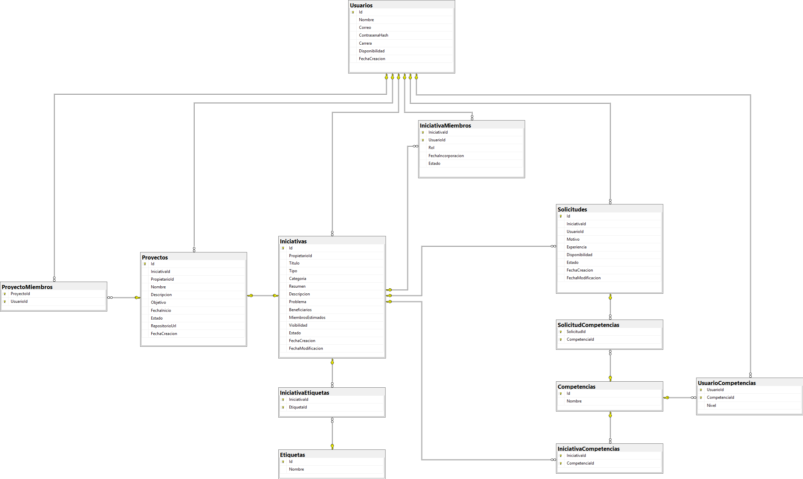

# Modelo de datos — Innovation Hub

## 1. Base de datos

Nombre: `innovation_hub`

Se utiliza MongoDB Atlas con el controlador oficial `mongodb` de Node.js.

## 2. Colección usuarios

Guarda la información de las personas registradas.

Campos principales:

- `_id`: identificador único.
- `nombre`: nombre completo.
- `correo`: correo único e inmutable.
- `contrasenaHash`: contraseña protegida.
- `carrera`: carrera del usuario.
- `competencias`: lista de competencias.
- `disponibilidad`: disponibilidad para colaborar.
- `fechaCreacion`: fecha de registro.

## 3. Colección iniciativas

Guarda las propuestas publicadas.

Campos principales:

- `_id`: identificador.
- `titulo`, `tipo`, `categoria`, `resumen`.
- `descripcion`, `problema`, `beneficiarios`.
- `competencias`: competencias requeridas.
- `etiquetas`: etiquetas para clasificar la iniciativa.
- `miembrosEstimados`: cantidad prevista de integrantes.
- `propietarioId`: referencia a usuarios.
- `miembros`: lista de identificadores de usuarios aceptados.
- `visibilidad`: publica, institucional, restringida o privada.
- `estado`: abierta, convertida o archivada.
- `fechaCreacion`, `fechaModificacion`.

## 4. Colección solicitudes

Guarda las solicitudes de participación.

Campos principales:

- `_id`: identificador.
- `iniciativaId`: referencia a iniciativas.
- `usuarioId`: referencia al solicitante.
- `motivo`, `experiencia`, `disponibilidad`.
- `competencias`: competencias declaradas.
- `estado`: pendiente, aceptada, rechazada o cancelada.
- `fechaCreacion`, `fechaModificacion`.

## 5. Colección proyectos

Guarda las iniciativas convertidas en proyectos.

Campos principales:

- `_id`: identificador.
- `iniciativaId`: referencia a la iniciativa original.
- `propietarioId`: referencia al propietario.
- `nombre`, `descripcion`, `objetivo`.
- `fechaInicio`, `estado`.
- `repositorioGitHub`: enlace opcional a GitHub.
- `miembros`: integrantes del equipo.
- `fechaCreacion`, `fechaModificacion`.

## 6. Relaciones

- Un usuario puede ser propietario de varias iniciativas.
- Una iniciativa tiene un único propietario.
- Una iniciativa puede recibir varias solicitudes.
- Una solicitud pertenece a una iniciativa y a un usuario.
- Una iniciativa puede tener varios integrantes.
- Una iniciativa puede requerir varias competencias.
- Una iniciativa puede tener varias etiquetas.
- Una iniciativa puede convertirse en proyecto cuando tiene al menos un integrante adicional al propietario.

## 7. Decisiones de diseño

Se utilizan referencias mediante identificadores para relacionar usuarios, iniciativas, solicitudes y proyectos.

Se utilizan arreglos embebidos para datos sencillos como competencias, etiquetas y miembros del equipo.

Esta combinación permite consultar las entidades por separado sin duplicar toda la información de los usuarios en cada iniciativa.

## 8. Validaciones e índices

- El correo del usuario debe ser único.
- Los identificadores relacionados deben existir.
- No se permiten solicitudes pendientes duplicadas del mismo usuario para la misma iniciativa.
- El servidor valida permisos, visibilidad y estados.
- Se utilizan índices para búsquedas frecuentes y restricciones de unicidad.

---

## 9. Diseño relacional para SQL Server

Para la entrega final de Innovation Hub se propone cambiar la base de datos de MongoDB a SQL Server.

El objetivo es conservar la información de los usuarios, iniciativas, solicitudes y proyectos, pero organizándola mediante tablas relacionadas.

En MongoDB utilizamos colecciones, referencias y arreglos. En SQL Server utilizaremos tablas, llaves primarias (PK) y llaves foráneas (FK) para representar esas relaciones.

### 9.1. Tablas propuestas

El diseño contempla las siguientes **12 tablas**:

| Tabla | Descripción |
|---|---|
| Usuarios | Guarda la información de los usuarios registrados. |
| Competencias | Contiene el catálogo de competencias. |
| UsuarioCompetencias | Relaciona los usuarios con sus competencias. |
| Iniciativas | Almacena las iniciativas publicadas. |
| IniciativaCompetencias | Relaciona las iniciativas con las competencias que requieren. |
| IniciativaMiembros | Guarda los integrantes de cada iniciativa. |
| Solicitudes | Almacena las solicitudes de participación. |
| SolicitudCompetencias | Relaciona las solicitudes con las competencias declaradas. |
| Proyectos | Guarda los proyectos creados a partir de iniciativas. |
| ProyectoMiembros | Relaciona los proyectos con sus integrantes. |
| Etiquetas | Contiene las etiquetas utilizadas para clasificar iniciativas. |
| IniciativaEtiquetas | Relaciona las iniciativas con sus etiquetas. |

Las tablas intermedias permiten representar las relaciones de muchos a muchos, evitando guardar listas de identificadores dentro de una misma columna.

### 9.2. Diagrama entidad-relación

El siguiente diagrama representa las 12 tablas propuestas para SQL Server, incluyendo sus llaves primarias, llaves foráneas y relaciones.

### 9.3. Relaciones principales

| Relación | Tipo | ¿Cómo se resuelve? |
|---|---|---|
| Usuario - Competencia | Muchos a muchos | Tabla intermedia UsuarioCompetencias. |
| Usuario - Iniciativa | Uno a muchos | PropietarioId en Iniciativas. |
| Iniciativa - Competencia | Muchos a muchos | Tabla intermedia IniciativaCompetencias. |
| Iniciativa - Etiqueta | Muchos a muchos | Tabla intermedia IniciativaEtiquetas. |
| Iniciativa - Solicitud | Uno a muchos | IniciativaId en Solicitudes. |
| Proyecto - Usuario | Muchos a muchos | Tabla intermedia ProyectoMiembros. |
| Proyecto - Iniciativa | Uno a uno opcional | IniciativaId en Proyectos, con restricción UNIQUE. |

### 9.4. Otras relaciones

- **Usuario - Solicitud:** un usuario puede realizar varias solicitudes. Se utiliza UsuarioId en Solicitudes.
- **Iniciativa - Usuario:** una iniciativa puede tener varios integrantes y un usuario puede participar en varias iniciativas. Se utiliza IniciativaMiembros.
- **Solicitud - Competencia:** una solicitud puede declarar varias competencias. Se utiliza SolicitudCompetencias.
- **Usuario - Proyecto:** además de participar en proyectos, un usuario puede ser propietario de varios. Se utiliza PropietarioId en Proyectos.

---

## 10. Del documento a la tabla

Para pasar de MongoDB a SQL Server, se deben transformar las colecciones, los arreglos y las referencias en tablas relacionadas.

En MongoDB, algunos datos se almacenan como arreglos dentro de un documento. En SQL Server, esos datos se organizan mediante tablas intermedias y llaves foráneas.

### 10.1. Conversión de las colecciones

| Colección en MongoDB | Tabla en SQL Server | Conversión |
|---|---|---|
| usuarios | Usuarios | Los campos del documento pasan a columnas. |
| iniciativas | Iniciativas | Los campos pasan a columnas y propietarioId se convierte en llave foránea. |
| solicitudes | Solicitudes | Los campos pasan a columnas y los identificadores de usuario e iniciativa se convierten en llaves foráneas. |
| proyectos | Proyectos | Los campos pasan a columnas y los identificadores de iniciativa y propietario se convierten en llaves foráneas. |

Las tablas Competencias y Etiquetas se agregan como catálogos para evitar repetir los mismos nombres en diferentes registros.

### 10.2. Conversión de arreglos y referencias

| Dato en MongoDB | Representación en SQL Server |
|---|---|
| usuarios.competencias | UsuarioCompetencias |
| iniciativas.competencias | IniciativaCompetencias |
| iniciativas.etiquetas | IniciativaEtiquetas |
| iniciativas.miembros | IniciativaMiembros |
| solicitudes.competencias | SolicitudCompetencias |
| proyectos.miembros | ProyectoMiembros |
| iniciativas.propietarioId | Iniciativas.PropietarioId |
| solicitudes.usuarioId | Solicitudes.UsuarioId |
| solicitudes.iniciativaId | Solicitudes.IniciativaId |
| proyectos.propietarioId | Proyectos.PropietarioId |
| proyectos.iniciativaId | Proyectos.IniciativaId |

Las referencias que antes utilizaban ObjectId se representarán mediante columnas de tipo INT en el modelo SQL Server propuesto.

Durante una futura migración será necesario conservar la equivalencia entre cada ObjectId original y el identificador numérico correspondiente.

### 10.3. Campos adicionales del diseño relacional

Además de los campos existentes en MongoDB, se proponen algunos campos para mejorar la organización de la información:

- `Competencias.Nombre`: permite mantener un catálogo de competencias.
- `Etiquetas.Nombre`: permite mantener un catálogo de etiquetas.
- `UsuarioCompetencias.Nivel`: permite indicar el nivel de una competencia.
- `IniciativaMiembros.Rol`: identifica el rol del integrante.
- `IniciativaMiembros.FechaIncorporacion`: registra cuándo ingresó.
- `IniciativaMiembros.Estado`: permite identificar si su participación está activa.

Estos campos son parte de la propuesta relacional y no necesariamente existen en los documentos actuales de MongoDB.

---

## 11. Descripción de las tablas

A continuación, se describen las 12 tablas creadas en SQL Server, sus columnas, tipos de datos y restricciones principales.

### 11.1. Tabla Usuarios

Almacena los datos de los usuarios registrados en Innovation Hub.

| Columna | Tipo de dato | Obligatorio | Llave | Regla |
|---|---|---|---|---|
| Id | INT | Sí | PK | IDENTITY(1,1) |
| Nombre | NVARCHAR(80) | Sí | — | Nombre del usuario |
| Correo | NVARCHAR(120) | Sí | — | UNIQUE |
| ContrasenaHash | NVARCHAR(255) | Sí | — | Contraseña protegida |
| Carrera | NVARCHAR(100) | No | — | NULL |
| Disponibilidad | NVARCHAR(200) | No | — | NULL |
| FechaCreacion | DATETIME2 | Sí | — | DEFAULT GETDATE() |

**Relaciones:** un usuario puede publicar iniciativas, realizar solicitudes, administrar proyectos y participar en iniciativas y proyectos.

### 11.2. Tabla Competencias

Contiene el catálogo de competencias que pueden asociarse con usuarios, iniciativas y solicitudes.

| Columna | Tipo de dato | Obligatorio | Llave | Regla |
|---|---|---|---|---|
| Id | INT | Sí | PK | IDENTITY(1,1) |
| Nombre | NVARCHAR(100) | Sí | — | UNIQUE |

**Relaciones:** una competencia puede asociarse con varios usuarios, iniciativas y solicitudes.

### 11.3. Tabla UsuarioCompetencias

Relaciona los usuarios con sus competencias.

| Columna | Tipo de dato | Obligatorio | Llave | Regla |
|---|---|---|---|---|
| UsuarioId | INT | Sí | PK, FK | Referencia Usuarios(Id) |
| CompetenciaId | INT | Sí | PK, FK | Referencia Competencias(Id) |
| Nivel | NVARCHAR(20) | No | — | basico, intermedio o avanzado |

**Llave primaria compuesta:** UsuarioId + CompetenciaId.

Esto evita que una misma competencia se asigne dos veces al mismo usuario.

### 11.4. Tabla Iniciativas

Guarda las iniciativas publicadas por los usuarios.

| Columna | Tipo de dato | Obligatorio | Llave | Regla |
|---|---|---|---|---|
| Id | INT | Sí | PK | IDENTITY(1,1) |
| PropietarioId | INT | Sí | FK | Referencia Usuarios(Id) |
| Titulo | NVARCHAR(150) | Sí | — | Título de la iniciativa |
| Tipo | NVARCHAR(60) | Sí | — | idea, necesidad o reto |
| Categoria | NVARCHAR(100) | Sí | — | Categoría |
| Resumen | NVARCHAR(500) | Sí | — | Resumen |
| Descripcion | NVARCHAR(MAX) | Sí | — | Descripción |
| Problema | NVARCHAR(3000) | No | — | NULL |
| Beneficiarios | NVARCHAR(1000) | No | — | NULL |
| MiembrosEstimados | INT | No | — | Mayor que cero si se indica |
| Visibilidad | NVARCHAR(20) | Sí | — | CHECK de visibilidad |
| Estado | NVARCHAR(20) | Sí | — | abierta, convertida o archivada |
| FechaCreacion | DATETIME2 | Sí | — | DEFAULT GETDATE() |
| FechaModificacion | DATETIME2 | Sí | — | DEFAULT GETDATE() |

**Relaciones:** cada iniciativa pertenece a un usuario y puede tener competencias, etiquetas, integrantes, solicitudes y un proyecto asociado.

**Regla de visibilidad:** publica, institucional, restringida o privada.

### 11.5. Tabla IniciativaCompetencias

Relaciona cada iniciativa con las competencias que requiere.

| Columna | Tipo de dato | Obligatorio | Llave | Regla |
|---|---|---|---|---|
| IniciativaId | INT | Sí | PK, FK | Referencia Iniciativas(Id) |
| CompetenciaId | INT | Sí | PK, FK | Referencia Competencias(Id) |

**Llave primaria compuesta:** IniciativaId + CompetenciaId.

### 11.6. Tabla IniciativaMiembros

Registra los usuarios que forman parte de una iniciativa.

| Columna | Tipo de dato | Obligatorio | Llave | Regla |
|---|---|---|---|---|
| IniciativaId | INT | Sí | PK, FK | Referencia Iniciativas(Id) |
| UsuarioId | INT | Sí | PK, FK | Referencia Usuarios(Id) |
| Rol | NVARCHAR(80) | No | — | NULL |
| FechaIncorporacion | DATETIME2 | Sí | — | DEFAULT GETDATE() |
| Estado | NVARCHAR(30) | Sí | — | activo o inactivo |

**Llave primaria compuesta:** IniciativaId + UsuarioId.

Esto impide registrar dos veces al mismo integrante en una iniciativa.

### 11.7. Tabla Solicitudes

Almacena las solicitudes de participación que realizan los usuarios.

| Columna | Tipo de dato | Obligatorio | Llave | Regla |
|---|---|---|---|---|
| Id | INT | Sí | PK | IDENTITY(1,1) |
| IniciativaId | INT | Sí | FK | Referencia Iniciativas(Id) |
| UsuarioId | INT | Sí | FK | Referencia Usuarios(Id) |
| Motivo | NVARCHAR(1000) | Sí | — | Motivo de participación |
| Experiencia | NVARCHAR(1000) | No | — | NULL |
| Disponibilidad | NVARCHAR(200) | Sí | — | Disponibilidad |
| Estado | NVARCHAR(20) | Sí | — | pendiente, aceptada, rechazada o cancelada |
| FechaCreacion | DATETIME2 | Sí | — | DEFAULT GETDATE() |
| FechaModificacion | DATETIME2 | Sí | — | DEFAULT GETDATE() |

**Regla adicional:** un índice único filtrado evita que un usuario tenga dos solicitudes pendientes para una misma iniciativa.

### 11.8. Tabla SolicitudCompetencias

Relaciona las solicitudes con las competencias declaradas por los usuarios.

| Columna | Tipo de dato | Obligatorio | Llave | Regla |
|---|---|---|---|---|
| SolicitudId | INT | Sí | PK, FK | Referencia Solicitudes(Id) |
| CompetenciaId | INT | Sí | PK, FK | Referencia Competencias(Id) |

**Llave primaria compuesta:** SolicitudId + CompetenciaId.

### 11.9. Tabla Proyectos

Guarda los proyectos que se crean a partir de iniciativas.

| Columna | Tipo de dato | Obligatorio | Llave | Regla |
|---|---|---|---|---|
| Id | INT | Sí | PK | IDENTITY(1,1) |
| IniciativaId | INT | Sí | FK | UNIQUE |
| PropietarioId | INT | Sí | FK | Referencia Usuarios(Id) |
| Nombre | NVARCHAR(150) | Sí | — | Nombre del proyecto |
| Descripcion | NVARCHAR(MAX) | Sí | — | Descripción |
| Objetivo | NVARCHAR(1000) | Sí | — | Objetivo |
| FechaInicio | DATE | Sí | — | Fecha de inicio |
| Estado | NVARCHAR(30) | Sí | — | CHECK de estado |
| RepositorioUrl | NVARCHAR(300) | No | — | NULL |
| FechaCreacion | DATETIME2 | Sí | — | DEFAULT GETDATE() |

**Relaciones:** cada proyecto pertenece a una iniciativa y tiene un propietario.

La restricción UNIQUE sobre IniciativaId garantiza que una iniciativa genere como máximo un proyecto.

**Estados del diseño SQL actual:** planificacion, en desarrollo, pausado, finalizado y archivado.

En MongoDB también se observa el estado `activo`. Por lo tanto, esta diferencia deberá revisarse antes de una migración real.

El campo `RepositorioUrl` de SQL Server corresponde a `repositorioGitHub` de MongoDB. El ejemplo real también contiene `fechaModificacion`, campo que se deberá incorporar si se requiere conservarlo durante la migración.

### 11.10. Tabla ProyectoMiembros

Relaciona los proyectos con sus integrantes.

| Columna | Tipo de dato | Obligatorio | Llave | Regla |
|---|---|---|---|---|
| ProyectoId | INT | Sí | PK, FK | Referencia Proyectos(Id) |
| UsuarioId | INT | Sí | PK, FK | Referencia Usuarios(Id) |

**Llave primaria compuesta:** ProyectoId + UsuarioId.

Esto evita que un usuario aparezca dos veces como integrante del mismo proyecto.

### 11.11. Tabla Etiquetas

Almacena las etiquetas utilizadas para clasificar las iniciativas.

| Columna | Tipo de dato | Obligatorio | Llave | Regla |
|---|---|---|---|---|
| Id | INT | Sí | PK | IDENTITY(1,1) |
| Nombre | NVARCHAR(50) | Sí | — | UNIQUE |

**Relaciones:** una etiqueta puede utilizarse en varias iniciativas.

### 11.12. Tabla IniciativaEtiquetas

Relaciona las iniciativas con sus etiquetas.

| Columna | Tipo de dato | Obligatorio | Llave | Regla |
|---|---|---|---|---|
| IniciativaId | INT | Sí | PK, FK | Referencia Iniciativas(Id) |
| EtiquetaId | INT | Sí | PK, FK | Referencia Etiquetas(Id) |

**Llave primaria compuesta:** IniciativaId + EtiquetaId.

Esto evita asignar dos veces la misma etiqueta a una iniciativa.

---

## 12. Llaves foráneas y eliminación de registros

Las llaves foráneas permiten mantener la integridad referencial de la base de datos.

Por ejemplo, no se puede crear una solicitud para una iniciativa que no existe.

### 12.1. Comportamiento de las relaciones

| Tabla | Llave foránea | Tabla relacionada | Eliminación |
|---|---|---|---|
| UsuarioCompetencias | UsuarioId | Usuarios | NO ACTION |
| UsuarioCompetencias | CompetenciaId | Competencias | NO ACTION |
| Iniciativas | PropietarioId | Usuarios | NO ACTION |
| IniciativaCompetencias | IniciativaId | Iniciativas | NO ACTION |
| IniciativaCompetencias | CompetenciaId | Competencias | NO ACTION |
| IniciativaMiembros | IniciativaId | Iniciativas | NO ACTION |
| IniciativaMiembros | UsuarioId | Usuarios | NO ACTION |
| Solicitudes | IniciativaId | Iniciativas | NO ACTION |
| Solicitudes | UsuarioId | Usuarios | NO ACTION |
| SolicitudCompetencias | SolicitudId | Solicitudes | NO ACTION |
| SolicitudCompetencias | CompetenciaId | Competencias | NO ACTION |
| Proyectos | IniciativaId | Iniciativas | NO ACTION |
| Proyectos | PropietarioId | Usuarios | NO ACTION |
| ProyectoMiembros | ProyectoId | Proyectos | NO ACTION |
| ProyectoMiembros | UsuarioId | Usuarios | NO ACTION |
| IniciativaEtiquetas | IniciativaId | Iniciativas | NO ACTION |
| IniciativaEtiquetas | EtiquetaId | Etiquetas | NO ACTION |

En los scripts se utiliza el comportamiento predeterminado de SQL Server, equivalente a NO ACTION.

Esto significa que SQL Server impedirá eliminar un registro si existen otros registros que dependen de él.

### 12.2. Justificación

Se decidió no utilizar eliminación automática en cascada porque Innovation Hub necesita conservar información importante.

Por ejemplo, si una iniciativa ya tiene solicitudes, integrantes o un proyecto asociado, no debería eliminarse junto con esos registros.

En esos casos, se debe utilizar el estado archivada para conservar el historial.

---

## 13. Plan de migración de MongoDB a SQL Server

La migración se realizará de manera ordenada para conservar los datos y sus relaciones.

### 13.1. Paso 1. Inventario de datos

Primero se revisarán las cuatro colecciones actuales:

- usuarios
- iniciativas
- solicitudes
- proyectos

Se identificarán los campos de cada documento, los arreglos y las referencias a otros documentos.

También se revisará cuáles campos son obligatorios, cuáles pueden estar vacíos y qué valores utilizan.

### 13.2. Paso 2. Mapeo de documentos a tablas

Cada colección principal se convertirá en una tabla.

Los arreglos de competencias, etiquetas y miembros se convertirán en tablas intermedias.

Las referencias entre documentos se convertirán en llaves foráneas.

Por ejemplo:

- `iniciativas.propietarioId` se convierte en `Iniciativas.PropietarioId`.
- `iniciativas.competencias` se convierte en registros de `IniciativaCompetencias`.
- `iniciativas.etiquetas` se convierte en registros de `IniciativaEtiquetas`.
- `proyectos.miembros` se convierte en registros de `ProyectoMiembros`.

### 13.3. Paso 3. Orden de creación de tablas

Las tablas se crearán respetando sus dependencias.

El orden utilizado en SQL Server es:

1. Usuarios y Competencias.
2. Iniciativas.
3. Solicitudes.
4. Proyectos.
5. UsuarioCompetencias, IniciativaCompetencias, IniciativaMiembros, SolicitudCompetencias y ProyectoMiembros.
6. Etiquetas e IniciativaEtiquetas.

Este orden permite crear primero las tablas principales y después las que dependen de ellas.

### 13.4. Paso 4. Conversión de identificadores

MongoDB utiliza identificadores ObjectId y el diseño actual de SQL Server utiliza identificadores numéricos INT.

Para conservar las relaciones en una futura migración se preparará una tabla de equivalencias.

Ejemplo:

| Colección | ObjectId original (ejemplo) | Nuevo Id |
|---|---|---|
| usuarios | 507f1f77bcf86cd799439011 | 1 |
| usuarios | 507f1f77bcf86cd799439012 | 2 |
| iniciativas | 507f1f77bcf86cd799439013 | 1 |

Estos identificadores son ilustrativos y no representan datos reales de la base actual.

Cuando se migre una iniciativa, su PropietarioId deberá utilizar el nuevo identificador numérico del usuario correspondiente.

Esta sección describe una posible migración futura. No implica modificar los identificadores de la aplicación Express actual.

### 13.5. Paso 5. Datos de prueba

Para comprobar el funcionamiento del modelo se propone utilizar un conjunto pequeño de datos.

Estos datos son ejemplos para validar las relaciones; no representan una migración ya ejecutada.

#### Usuarios

| Id | Nombre | Correo | Carrera |
|---|---|---|---|
| 1 | Ana Rodríguez | ana@ejemplo.com | Ingeniería de Software |
| 2 | Carlos Mora | carlos@ejemplo.com | Ingeniería de Software |
| 3 | María López | maria@ejemplo.com | Diseño |

Los demás campos obligatorios se completarían con valores válidos al insertar los registros.

#### Competencias

| Id | Nombre |
|---|---|
| 1 | JavaScript |
| 2 | React |
| 3 | SQL Server |
| 4 | Diseño UX |
| 5 | Comunicación |

#### UsuarioCompetencias

| UsuarioId | CompetenciaId | Nivel |
|---|---|---|
| 1 | 1 | avanzado |
| 1 | 3 | intermedio |
| 2 | 2 | avanzado |
| 2 | 3 | intermedio |
| 3 | 4 | avanzado |
| 3 | 5 | intermedio |

#### Iniciativas

| Id | PropietarioId | Titulo | Visibilidad | Estado |
|---|---|---|---|---|
| 1 | 1 | Plataforma de tutorías | publica | abierta |
| 2 | 2 | Sistema de biblioteca | institucional | abierta |
| 3 | 3 | Aplicación de voluntariado | restringida | abierta |

Los campos restantes se completarían con información válida según la estructura de la tabla.

#### IniciativaCompetencias

| IniciativaId | CompetenciaId |
|---|---|
| 1 | 1 |
| 1 | 2 |
| 2 | 3 |
| 3 | 4 |
| 3 | 5 |

#### IniciativaMiembros

| IniciativaId | UsuarioId | Rol | Estado |
|---|---|---|---|
| 1 | 1 | Propietario | activo |
| 1 | 2 | Desarrollador | activo |
| 2 | 2 | Propietario | activo |
| 3 | 3 | Propietario | activo |

#### Solicitudes

| Id | IniciativaId | UsuarioId | Motivo | Disponibilidad | Estado |
|---|---|---|---|---|---|
| 1 | 1 | 2 | Quiero colaborar en el desarrollo | Tardes | aceptada |
| 2 | 2 | 3 | Me interesa participar en el diseño | Fines de semana | pendiente |

Los demás campos obligatorios se completarían con valores válidos.

#### SolicitudCompetencias

| SolicitudId | CompetenciaId |
|---|---|
| 1 | 2 |
| 2 | 4 |

#### Proyectos

| Id | IniciativaId | PropietarioId | Nombre | Estado |
|---|---|---|---|---|
| 1 | 1 | 1 | Proyecto Tutorías | en desarrollo |

Los campos de descripción, objetivo y fecha de inicio se completarían con valores válidos.

#### ProyectoMiembros

| ProyectoId | UsuarioId |
|---|---|
| 1 | 1 |
| 1 | 2 |

#### Etiquetas

| Id | Nombre |
|---|---|
| 1 | Educación |
| 2 | Tutorías |
| 3 | Tecnología |
| 4 | Voluntariado |
| 5 | Comunidad |

#### IniciativaEtiquetas

| IniciativaId | EtiquetaId |
|---|---|
| 1 | 1 |
| 1 | 2 |
| 1 | 3 |
| 2 | 1 |
| 2 | 3 |
| 3 | 4 |
| 3 | 5 |

Estos datos permiten comprobar la relación muchos a muchos entre iniciativas y etiquetas.

Por ejemplo, la iniciativa Plataforma de tutorías tiene tres etiquetas: Educación, Tutorías y Tecnología.

La etiqueta Educación también está relacionada con Sistema de biblioteca.

Con estos datos se pueden comprobar las relaciones entre usuarios, competencias, etiquetas, iniciativas, solicitudes y proyectos.

### 13.6. Paso 6. Validación de la migración

Después de migrar los datos se realizarán las siguientes comprobaciones:

1. Comparar la cantidad de documentos de cada colección con la cantidad de registros de su tabla principal.
2. Verificar que todos los usuarios, iniciativas, solicitudes y proyectos tengan sus datos correspondientes.
3. Comprobar que las llaves foráneas apunten a registros existentes.
4. Revisar que los arreglos de competencias, etiquetas y miembros se hayan convertido correctamente en registros de las tablas intermedias.
5. Confirmar que no existan relaciones duplicadas.
6. Ejecutar consultas JOIN para comprobar que las relaciones funcionan.
7. Verificar las restricciones UNIQUE, CHECK y NOT NULL.

La migración se considerará correcta cuando se conserven los datos, las relaciones y las reglas principales del sistema.

---

## 14. Consideraciones finales

El modelo relacional propuesto permite representar en SQL Server la información que actualmente maneja Innovation Hub en MongoDB.

La separación de datos en tablas facilita la organización y permite utilizar llaves primarias, llaves foráneas y restricciones para mantener la integridad de la información.

Las tablas intermedias resuelven las relaciones de muchos a muchos, como usuarios con competencias, iniciativas con etiquetas y proyectos con integrantes.

También se conserva la relación entre las iniciativas y los proyectos, garantizando que una iniciativa pueda generar como máximo un proyecto.

Este diseño servirá como base para la futura implementación con ASP.NET Core y Entity Framework Core.

Durante esa implementación será necesario mantener los nombres de campos y formatos de respuesta que utiliza actualmente la API, para evitar cambios innecesarios en el cliente React.
